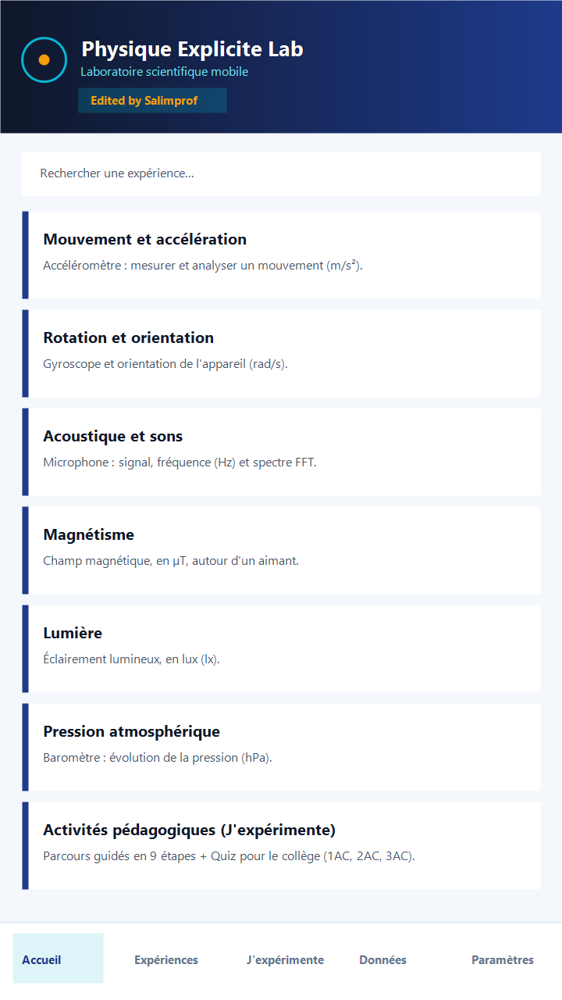
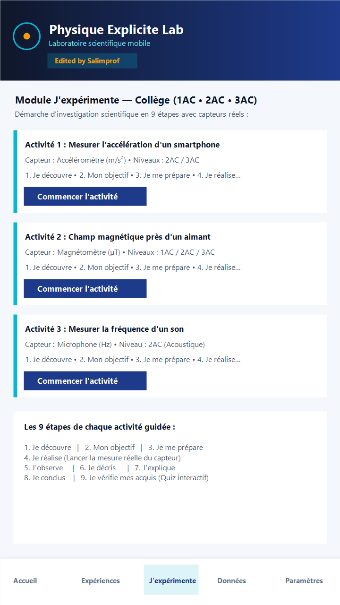
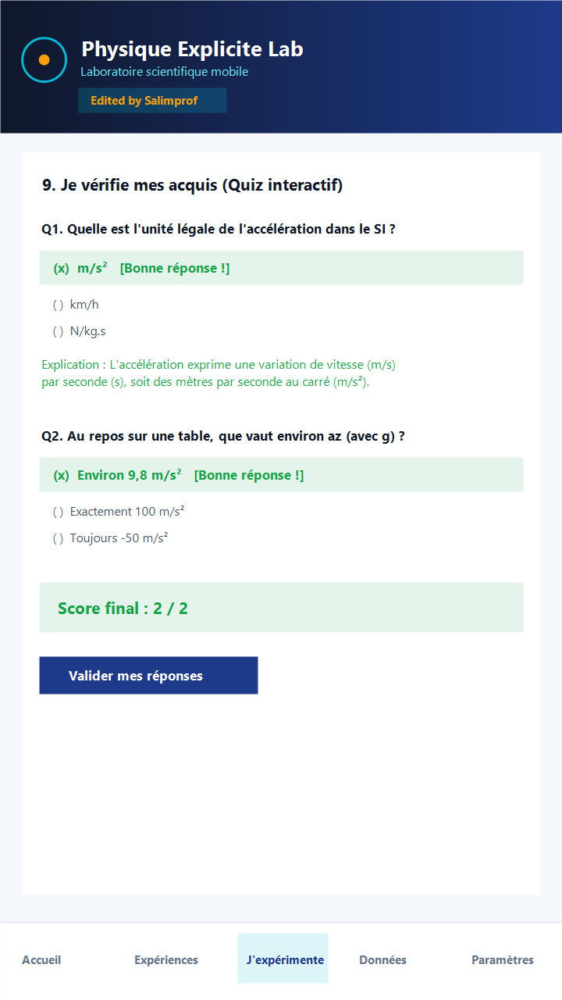
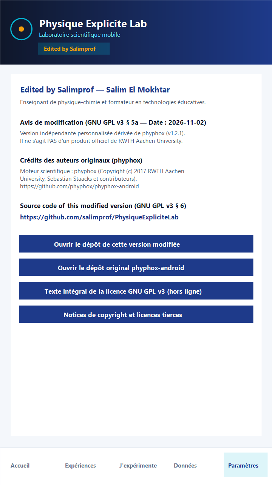

# Physique Explicite Lab — *Edited by Salimprof*

<p align="center">
  
</p>

<p align="center">
  <strong>🇫🇷 <a href="#-présentation-français">Version Française</a></strong> •
  <strong>🇬🇧 <a href="#-overview-english">English Version</a></strong> •
  <strong>⚖️ <a href="NOTICE_MODIFICATIONS_GPLv3.md">Notice GNU GPL v3</a></strong> •
  <strong>🔒 <a href="PRIVACY_POLICY.md">Politique de Confidentialité / Privacy Policy</a></strong>
</p>

---

## 🇫🇷 Présentation (Français)

**Physique Explicite Lab** (nom court : **PE Lab**, signature : **Edited by Salimprof**) est une application Android scientifique et pédagogique qui transforme un smartphone en véritable laboratoire de physique expérimentale.

Elle est conçue par **Salim El Mokhtar (Salimprof)** — enseignant de physique-chimie et formateur en technologies éducatives — à destination des élèves et des enseignants de physique-chimie du cycle secondaire collégial marocain (**1AC, 2AC, 3AC**) ainsi que des clubs scientifiques.

> [!IMPORTANT]
> **Avis d'indépendance et de modification (GNU GPL v3, Section 5 & Section 7) :**  
> **Physique Explicite Lab (« Edited by Salimprof »)** est une version personnalisée indépendante (modifiée le `2026-11-02`) dérivée du projet open source **[phyphox](https://phyphox.org)** ([`phyphox-android`](https://github.com/phyphox/phyphox-android), base v1.2.1) créé au 2e Institut de Physique de la **RWTH Aachen University** par **Dr. Sebastian Staacks** et ses collaborateurs.  
> **Il ne s'agit PAS d'un produit officiel de la RWTH Aachen University ni de l'équipe phyphox.** Les noms *« phyphox »* et *« RWTH Aachen University »* ainsi que leurs logos respectifs sont des marques déposées de leurs titulaires.

### Identité technique du projet
| Paramètre | Valeur dans le dépôt |
|---|---|
| **Nom de l'application** | `Physique Explicite Lab` |
| **Signature d'édition** | `Edited by Salimprof` (Salim El Mokhtar) |
| **Identifiant Android (`applicationId`)** | `com.salimprof.physiqueexplicitelab` |
| **Version (`versionName` / `versionCode`)** | `1.0.0-pe (base phyphox 1.2.1)` / `1020105` |
| **SDK Android** | `minSdkVersion 21` (Android 5.0+) • `targetSdkVersion 35` (Android 15) • `compileSdk 37` |
| **Licence** | [GNU General Public License v3.0 (GNU GPL v3)](LICENSE) (embarquée hors ligne dans [`app/src/main/assets/gpl-3.0.txt`](app/src/main/assets/gpl-3.0.txt)) |
| **Dépôt du code source modifié** | https://github.com/salimprof/PhysiqueExpliciteLab |
| **Dépôt amont original (`phyphox`)** | https://github.com/phyphox/phyphox-android |

### Fonctionnalités principales
1. **Navigation moderne en 5 onglets ([`PEMainActivity`](app/src/main/java/de/rwth_aachen/phyphox/pelab/PEMainActivity.java))** :
   - **Accueil** : Recherche instantanée et cartes thématiques par domaine physique (*Mouvement et accélération*, *Rotation et orientation*, *Acoustique et sons*, *Magnétisme*, *Lumière*, *Pression atmosphérique*, *Localisation GPS*, *Expériences favorites*, *Activités pédagogiques*).
   - **Expériences** : Catalogue complet des expériences capteurs avec filtrage par catégorie, gestion des favoris ([`PEFavoritesManager`](app/src/main/java/de/rwth_aachen/phyphox/pelab/PEFavoritesManager.java)) et détection automatique des capteurs présents sur l'appareil.
   - **J'expérimente ([`PEPedagogyManager`](app/src/main/java/de/rwth_aachen/phyphox/pelab/PEPedagogyManager.java))** : Module pédagogique guidé en **9 étapes** structurant la démarche d'investigation scientifique au collège (**1AC, 2AC, 3AC**) :
     1. *Je découvre* • 2. *Mon objectif* • 3. *Je me prépare* • 4. *Je réalise* (avec lancement direct de la mesure réelle du capteur) • 5. *J'observe* • 6. *Je décris* • 7. *J'explique* • 8. *Je conclus* • 9. *Je vérifie mes acquis (Quiz interactif)*.
   - **Données** : Consultation locale des mesures enregistrées et des expériences personnalisées.
   - **Paramètres** : Choix du thème (*Système*, *Clair*, *Sombre*), choix de la langue (**Français**, **Arabe** avec support RTL complet, **Anglais**), préférences du moteur graphique, fenêtre **Edited by Salimprof**, crédits, texte intégral hors ligne de la licence GNU GPL v3 et politique de confidentialité.
2. **Moteur scientifique `phyphox` intégralement préservé** :
   - Acquisition matérielle haute fréquence (`SensorInput`, `AudioInput`, `GpsInput`, `CameraInput`, `DepthInput`, Bluetooth Low Energy).
   - Analyse mathématique native C++/JNI (FFT via `FFTW`, autocorrélation, filtrage) et graphiques temps réel interactifs.
   - Exportation des mesures aux formats CSV, TSV et Excel (`.xlsx`).

### Captures d'écran / Aperçu de l'interface

<p align="center">
  
  
  
  
</p>

### Instructions de compilation reproductible (Complete Corresponding Source)

#### 1. Cloner le dépôt avec ses sous-modules Git requis
Le projet utilise deux sous-modules Git actifs déclarés dans [`.gitmodules`](.gitmodules) :
- `app/src/main/assets/experiments` ([`Staacks/phyphox-experiments`](https://github.com/Staacks/phyphox-experiments), commit `af5c1a52`) : définitions XML `.phyphox` des expériences scientifiques intégrées.
- `app/src/main/assets/remote` ([`Staacks/phyphox-webinterface`](https://github.com/Staacks/phyphox-webinterface), commit `67c3ef32`) : interface web servie localement lors de l'activation de l'accès à distance.

```bash
git clone --recurse-submodules https://github.com/salimprof/PhysiqueExpliciteLab.git
cd PhysiqueExpliciteLab
# Si le dépôt a déjà été cloné sans --recurse-submodules :
git submodule update --init --recursive
```

#### 2. Prérequis d'environnement
- **JDK 21** (ex. Eclipse Temurin 21)
- **Android SDK** (`platforms;android-37.0`, `build-tools;36.0.0`, `ndk;28.0.13004108`, `cmake;3.22.1`)

#### 3. Exécuter les tests et compiler l'APK / l'AAB
```powershell
# Exécuter les tests unitaires (incluant PELabVerificationTest)
.\gradlew.bat testRegularDebugUnitTest

# Générer l'APK Debug installable
.\gradlew.bat assembleRegularDebug
# Sortie : app/build/outputs/apk/regular/debug/app-regular-debug.apk

# Générer l'Android App Bundle (AAB) Release pour Google Play
.\gradlew.bat bundleRegularRelease
# Sortie : app/build/outputs/bundle/regularRelease/app-regular-release.aab
```
Pour les détails de signature cryptographique (`apksigner` / `jarsigner`), consultez [`COMPILE_AND_SIGNING_GUIDE.md`](COMPILE_AND_SIGNING_GUIDE.md).

---

## 🇬🇧 Overview (English)

**Physique Explicite Lab** (short name: **PE Lab**, signature: **Edited by Salimprof**) is a scientific and educational Android application that turns a smartphone into an experimental physics laboratory.

Customized on **2026-11-02** by **Salim El Mokhtar (Salimprof)** — physics and chemistry teacher and educational technology trainer — it is designed for middle school physics and chemistry students and teachers (**1AC, 2AC, 3AC**) and science clubs.

> [!IMPORTANT]
> **Independence & Modification Notice (GNU GPL v3, Section 5 & Section 7):**  
> **Physique Explicite Lab ("Edited by Salimprof")** is an independent customized version derived from the open-source **[phyphox](https://phyphox.org)** project ([`phyphox-android`](https://github.com/phyphox/phyphox-android), base v1.2.1), created at the 2nd Institute of Physics of **RWTH Aachen University** by **Dr. Sebastian Staacks** and contributors.  
> **This is NOT an official RWTH Aachen University or phyphox product.** The names *"phyphox"* and *"RWTH Aachen University"* as well as the RWTH Aachen logo are registered trademarks of their respective owners.

### Key Customizations & Features
- **Distinct Android Package & Branding**: `com.salimprof.physiqueexplicitelab` (can be installed alongside the original `de.rwth_aachen.phyphox` app without package or `FileProvider` conflicts).
- **5-Tab Educational Interface ([`PEMainActivity`](app/src/main/java/de/rwth_aachen/phyphox/pelab/PEMainActivity.java))**: *Home*, *Experiments*, *Let's experiment (`J'expérimente`)*, *Data*, and *Settings*.
- **9-Step Guided Inquiry Module & Interactive Quiz ([`PEPedagogyManager`](app/src/main/java/de/rwth_aachen/phyphox/pelab/PEPedagogyManager.java))**: Guides middle-school students from problem discovery and hypothesis to real sensor measurement and an interactive multiple-choice quiz with instant scientific explanations.
- **Trilingual UI (French, Arabic with full RTL layout support, English)** and Light/Dark themes.
- **Unmodified Scientific Engine**: Preserves 100% of the upstream `phyphox` sensor, audio, GPS, BLE, camera, C++/FFTW analysis, graphing, and remote-access engine.

---

## 📜 Crédits des auteurs originaux & Licences tierces / Original Credits & Third-Party Licenses

### Auteurs originaux du moteur `phyphox`
- **Copyright © 2016–2024 Dr. Sebastian Staacks, 2nd Institute of Physics, RWTH Aachen University** et l'ensemble des contributeurs du projet [phyphox](https://phyphox.org) ([`https://github.com/phyphox/phyphox-android`](https://github.com/phyphox/phyphox-android)).
- Distribué sous licence **GNU General Public License v3.0 (GNU GPL v3)** — voir [`LICENSE`](LICENSE) et [`app/src/main/assets/gpl-3.0.txt`](app/src/main/assets/gpl-3.0.txt).

### Bibliothèques tierces utilisées / Used Third-Party Libraries
- **FFTW** (`http://www.fftw.org`) : Calcul des transformées de Fourier rapides. Copyright © 2003, 2007-11 Matteo Frigo, Copyright © 2003, 2007-11 Massachusetts Institute of Technology. Distribué sous licence GNU GPL (v2 ou ultérieure ; utilisé sous GPL v3).
- **jlhttp** (`https://www.freeutils.net/source/jlhttp/`) : Serveur web HTTP local pour la fonctionnalité d'accès à distance, par Amichai Rothman. Distribué sous licence GNU GPL v3.
- **ZXing & ZXing Android Embedded** (`https://github.com/zxing/zxing`, `https://github.com/journeyapps/zxing-android-embedded`) : Lecture de codes QR. Distribué sous licence **Apache License 2.0** (incluant les notices Barcode4J — Copyright 2002-2010 Jeremias Märki, Copyright 2005-2006 Dietmar Bürkle — et JCommander — Copyright 2010 Cedric Beust).
- **AndroidSVG** (`com.caverock:androidsvg:1.4`) : Rendu vectoriel SVG. Copyright © 2013–2019 Paul LeBeau / CaveRock Software Ltd. Distribué sous **Apache License 2.0**.
- **Apache Commons IO** (`org.apache.commons:commons-io:1.3.2`) : Copyright © The Apache Software Foundation. Distribué sous **Apache License 2.0**.
- **AndroidX, CameraX, Material Components for Android & Kotlin Coroutines** : Copyright © The Android Open Source Project / Google LLC / JetBrains s.r.o. Distribués sous **Apache License 2.0**.
- **Ressources de l'interface Web distante (`app/src/main/assets/remote`)** : **Chart.js** (MIT License), **Normalize.css** (MIT License), police **Open Sans** (SIL OFL / Apache 2.0).
- *(Note : la communication MQTT 3.1.1 est assurée par le client interne `NetworkConnection/Mqtt/MqttClient.java` sous licence GNU GPL v3 ; l'ancienne dépendance externe `paho.mqtt.android` a été retirée en amont).*
